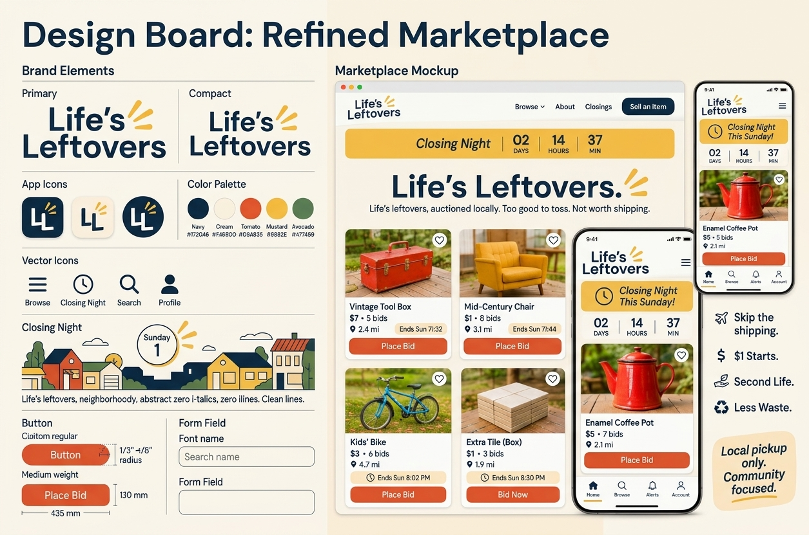

# Life's Leftovers — V1 Product Spec

Owner: Scott · Started Nov 10, 2026 · Exported for implementation Nov 15, 2026

> Source of truth for *what* to build and *why*. CLAUDE.md covers *how* to work in this repo; docs/MILESTONES.md covers the build order.

## Positioning

> **Life's leftovers, auctioned locally. Too good to toss. Not worth shipping.**

This tagline is locked. Every page, email and post should sound like it. The site is a local, timed-auction marketplace for the stuff in your garage, closet and basement. Every auction starts at $1 and ends on a weekly Closing Night.

**Secondary lines to consider later:**

- "What Facebook Marketplace should have been." Kept (Nov 14): it headlines the promise block on the landing page. Also strong for ads, launch posts and press pitches, where comparison grabs attention. Keep it out of the logo, name and main tagline: naming another company's brand there invites trademark trouble, and the comparison should stay truthful (no scams, no haggling, payment protection).

Two kinds of leftovers, one site:

- **Project leftovers:** the roll of metal flashing, extra cabinet doors, half a box of tile, spare lumber.
- **Life-chapter leftovers:** three bags of cheer and lacrosse uniforms after a kid leaves for college, outgrown toys, abandoned hobbies, odd kitchen gadgets.

The tone is playful and a little kitschy, like a garage sale with a countdown clock. It's not industrial and not boutique.

**Not just junk.** "Leftovers" means anything you're done with, not only things nobody wants. A designer purse that would fetch $40–50 on Poshmark belongs here as much as a roll of flashing: the seller sets a fair starting price, skips shipping and Poshmark's cut, and a local buyer picks it up. The fun tone stays; the price range is wide open. Low-value items get the $1 spotlight, and nicer pieces get their own "Nice Finds" row on the wall.

| Alternative | What frustrates people | How this is different |
| --- | --- | --- |
| Facebook Marketplace | Scams, haggling, "is this available?" ghosting | Bidding replaces haggling; in-app payment; verified users |
| eBay | 13%+ fees, shipping bulky low-value items | Local pickup; much lower fees |
| Maxsold | Built for whole-house cleanouts | Single items and small lots |
| Whatnot | You have to go live on video | Snap a photo and walk away |

## Decisions log

These are settled. Change them only on purpose, and add a new row when you do.

| Date | Decision | Why |
| --- | --- | --- |
| Nov 20, 2026 | Listing AI uses Claude Haiku 5.5 (`ai.model`), at low effort. Haiku has no server-side refusal fallback, so a refusal sends the listing to review, as an error does | Owner's call for the budget: about 0.1¢ per listing (under $1 a month at 200 a week) versus 3–4¢ on Opus 5.5; the job is short extraction and classification |
| Nov 20, 2026 | Listing AI (title, category, condition, details and a suggested start from the photos; moderation) runs only when `ANTHROPIC_API_KEY` is set, on one model set in config (`ai.model`, Claude Opus 5.5 at low effort, server-side refusal fallback on). Without a key the seller fills in the form and free keyword rules moderate. Keyword rules always run first, so obvious banned items never cost an API call; an AI refusal or error sends the listing to review, never straight to live. "Why it's here" is never AI-written | Strict budget: estimated about $0.03–0.04 per listing on Opus 5.5 (about $30/month at 200 listings a week) versus about $0.001 on Claude Haiku 5.5; the model choice is the owner's. A review queue is the safe default when unsure |
| Nov 20, 2026 | Sell flow: step 1 photos (the draft is created with the first photo, so it's resumable), step 2 the review screen from `Sell.dc.html` plus the fields the checklist needs that the mockup omits: condition, details, lot and free toggles, brand-name proof, pickup windows and "if nobody bids" | Matches "photos first, then the AI-filled review" while covering every required field |
| Nov 20, 2026 | Pickup windows are a day after Closing Night (1–6, shown as Mon–Sat for a Sunday metro) plus a block: morning 9–12, afternoon 12–5, evening 5–8 (config). 1 to 6 per listing; default Mon evening and Sat morning | Survives relisting unchanged and needs no calendar; the winner picks one in M7 |
| Nov 20, 2026 | Brand-name proof (tag, inside, serial photos plus an authenticity checkbox) is required when the seller marks a brand-name item and its start price or the AI's suggestion is $50 or more. Not for free items. Lot and Free can combine (a free lot) | The spec's "branded items over ~$50" needed a trigger; the seller's checkbox plus price is simple and visible |
| Nov 20, 2026 | Photos: the phone converts HEIC (decoder loaded only for HEIC files), applies rotation, resizes to 2048 px and re-encodes JPEG at 80%, dropping all metadata; it uploads to a private `u/` key with a 5-minute presigned PUT; the server checks type and size, re-encodes with sharp (metadata dropped again) into public `p/<id>.jpg`, and deletes the raw upload. Photo pickers stay disabled until the page is interactive | "Strip twice", and a photo picked before hydration would otherwise be lost. Only processed photos are ever public (bucket policy covers `p/*` only) |
| Nov 20, 2026 | A listing stores its Closing Night as a local date, chosen from the next two at least 3 days out. In a city that isn't open it's saved with no date and isn't public until the city opens (it counts toward "listings to open"). The exact pickup address is collected in M7 | M5 adds per-item slot times; M7 owns pickup. Keeps M3 small |
| Nov 20, 2026 | Edit rules: everything before the first bid; after it, add photos and append-only notes (keyword-screened); cancel only before bids. Bids arrive in M4, so every listing has zero bids until then. A new listing passes Turnstile (verified on our server) | SPEC "Edit or cancel a listing" and "Turnstile on sign-up, listing and first bid" |
| Nov 20, 2026 | Keyword moderation ignores tool and toy "guns" (nail gun, glue gun, heat gun, Nerf…) | They're everyday garage leftovers; flagging them would flood the review queue |
| Nov 20, 2026 | The VoIP line-type check is on (`accounts.rejectVoipNumbers: true`): internet numbers like Google Voice are refused before a code is texted. It applies wherever real Twilio keys are set; the local dev code skips Twilio | Owner's call: about $0.008 per check is worth keeping throwaway accounts out, as the spec asks |
| Nov 19, 2026 | Geography: every US zip (2025 Census ZCTA centroids, committed in `data/geo`) belongs to the nearest metro whose service radius covers it (Houston: 40 mi from downtown, which takes in The Woodlands, Conroe, Katy, Fulshear and League City but not Galveston), then to the area that lists it, else the nearest area center. Areas are a few anchor zips (which set the center) plus pinned extras | Sellers never pick an area; nearest-center is automatic, and pinned zips fix the few places it guesses wrong (77027 → Galleria, Rosenberg → Sugar Land). Committing the data keeps loads independent of the Census site |
| Nov 19, 2026 | `pnpm db:geo` loads geography in any environment and creates starter metros only if missing (Houston "seeding", Austin, San Antonio and Dallas–Fort Worth "waitlist"); it never edits an existing metro. The local seed opens Houston | Metros are admin-owned once they exist; production must not go public until launch |
| Nov 19, 2026 | Auto-widen moves in 5-mile steps (the slider's step) to the first radius with 12+ auctions, up to 50 mi. If 50 mi still has fewer, it shows what's there (widening only if that adds results), and zero results show "Nothing near you yet. Widen your radius?" | Matches the spec's example ("within 30 miles") and voice; never a bare zero |
| Nov 19, 2026 | Browse location is a zip plus radius in a cookie (`ll_location`); signed-in members fall back to their home zip, and their first chosen location becomes their home zip if they have none. "Use my location" sends coordinates once to find the nearest zip (within 25 mi); coordinates are never stored | Users share a location once; nothing more exact than a zip is ever kept |
| Nov 19, 2026 | The "not open yet" screen also covers seeding metros and zips outside every metro ("We're not in your area yet", no List anyway). Waitlist signups are one row per email per place; signed-in members join with one tap, others give an email and pass Turnstile (verified on our server). "Open your city" records Founding Host interest on the same signup. The Houston preview strip and saved-listing progress fill in when listings exist (M3) | Smallest version of SPEC "Cold start" that never shows an empty room; no new tables for host applications yet |
| Nov 19, 2026 | Profile home zips must be real zips (in the ZCTA table); format-only checking ended with M2 | Zips drive distance and metro; a fake zip would break both |
| Nov 15, 2026 | Email sign-in sends one email with both a link and a 6-digit code; no passwords. Sign-up and sign-in are the same step. The link verifies a token hash at `/auth/confirm`, so it works on any device | Links from an installed iPhone web app open in Safari, not the app; typing the code works everywhere. Token-hash links don't break when opened on a different device |
| Nov 15, 2026 | Turnstile is enforced by Supabase Auth itself (its captcha setting) on email sign-up and sign-in. Google sign-in has no Turnstile step | Checking it in Supabase means the bot check can't be skipped by calling Auth directly. Google runs its own bot checks |
| Nov 15, 2026 | The "Continue with Google" button appears only when Supabase reports Google enabled; there's no separate app setting. Locally Google is off until `supabase/.env` has an OAuth client (README) | One switch to flip; nothing to keep in sync between Supabase and Vercel |
| Nov 15, 2026 | Phone check: US numbers only; one account per number (database unique index); deleting an account frees its number. Twilio's VoIP line-type lookup is built and tested but off (`accounts.rejectVoipNumbers`) until the owner turns it on | US-only fits one Houston metro and blocks international SMS-pumping fraud. The lookup costs about $0.008 per check, and the budget is tight |
| Nov 15, 2026 | The dev-only phone code is `000000`, on when `ALLOW_DEV_OTP=1`. "Production" means Vercel's `VERCEL_ENV=production` (set automatically), not `NODE_ENV`: the app refuses to start there with the dev code or fast clock on, and the verifier refuses it again in code | Local end-to-end tests run a production build (`NODE_ENV=production`) and need the dev code; `VERCEL_ENV` can't be forgotten on the live site |
| Nov 15, 2026 | Display names: Google sign-ups start as "First L."; email sign-ups start with no name rather than a name guessed from the address. Home zip is checked for format only until metros and areas exist (M2) | Never expose part of someone's email publicly. Neighbors see the name on bids and ratings |
| Nov 15, 2026 | Account deletion deletes the Supabase Auth user, which cascades to the profile and phone number. When listings, bids and orders exist (M3+), deletion must keep order records for tax purposes (anonymized) instead of deleting them | Matches "Account deletion" in Build defaults with nothing to retain yet; flags the later constraint |
| Nov 15, 2026 | Rate limiting for M1 relies on Supabase Auth's built-in sign-in limits and Twilio Verify's send limits plus Fraud Guard. App-level limits (Upstash) arrive with M10 | Both services already limit the two endpoints M1 adds; M10 owns rate limiting across bidding, messaging and listing |
| Nov 15, 2026 | Locally the app runs on port 3100 (`pnpm dev`, Auth redirects, Inngest, Stripe CLI, storage CORS) and Playwright serves its build on 3200 | Port 3000 is often taken by the owner's other projects; e2e on its own port means a running dev server never answers a test run |
| Nov 15, 2026 | Launch doesn't wait for a listing count. The first Closing Nights run on the owner's own garage items, however many that is; the old "150+ live auctions" launch target is dropped. Closing Night stays Sunday 7–9 PM at one item a minute (120 slots). If a night ever has more listings than slots, the scheduler puts more than one item in a minute rather than running past 9 PM; a second Closing Night is the longer-term fix | The owner is seller number one and may not have 120 items at launch. Small nights are fine, because auto-widen and the countdown keep the wall from feeling empty. This also settles the 120-slot vs 150-listing conflict |
| Nov 15, 2026 | No Apple sign-in in V1: email link and Google only | Apple sign-in requires the $99/year Apple Developer Program, and the project is on a strict budget. The email link works fine on iPhones. Supabase can add Apple later without schema changes |
| Nov 15, 2026 | Buyer's premium rounds to the nearest cent (half up), minimum $1: a $14 win pays $1.40, not the mockup's whole-dollar $1. The bid sheet shows cents | Matches "10%" exactly and the integer-cents rule; whole-dollar rounding drifts from 10% on small sales |
| Nov 15, 2026 | All data access is server-side through Drizzle. Supabase JS is used only for Auth sessions and Realtime Broadcast. Every table has RLS on with no anon/authenticated policies, and the `public` schema is not exposed through Supabase's REST API | Keeps the bid transaction, address privacy and contact blocking in one enforced place; nothing can be queried around them from the browser |
| Nov 15, 2026 | Drizzle owns migrations for the `public` schema (`drizzle/`); Supabase CLI migrations are unused. Supabase's new publishable/secret API keys, not the legacy anon/service-role keys | One migration path in every environment; the legacy keys are being retired |
| Nov 15, 2026 | Local R2 stand-in is RustFS (MinIO-compatible), not MinIO | MinIO stopped publishing container images in 2025; RustFS speaks the same S3 API with the same ports |
| Nov 15, 2026 | The single local inbox is the Mailpit bundled with the Supabase CLI (UI :54324, SMTP :54325), not a separate Mailpit in docker-compose | Supabase Auth refuses unauthenticated plaintext SMTP to any host but localhost, so a separate Mailpit can't receive sign-in emails; one inbox catches Auth and app mail |
| Nov 15, 2026 | Added tokens `brand-tomato-strong` #C43E2A (primary buttons), `brand-tomato-deep` #9E2F1F and `brand-navy-deep` #12273F (hover), and the mockups' neutrals: `brand-ink-muted` #4F5F70, `brand-sand` #E9DFCE, `brand-line` #D6CCBB, `brand-line-strong` #B9AE9C | They're used throughout the approved mockups; named tokens keep raw hex out of components |
| Nov 15, 2026 | Develop on native Windows with Docker Desktop instead of WSL2; CI runs on Linux. Node 24 LTS pinned | The tools were already installed on Windows and the WSL distro (Ubuntu 20.04) is out of support; CI catches platform differences. Move to Node 26 when Vercel defaults to it |
| Nov 15, 2026 | Sentry and PostHog run only in production builds with keys set. Sentry collects no user info, cookies, bodies or query strings, and events are scrubbed of emails, phones, card numbers and tokens. PostHog has no session recording and no autocapture | "Never log card data, full addresses, phone numbers or auth tokens"; chat and pickup screens show addresses |
| Nov 14, 2026 | Brand navy changed from #172D46 to #1B385B | Side-by-side test: the original read as black in the small logo; #1B385B is clearly navy and still about 10:1 on cream |
| Nov 13, 2026 | Name, domain and brand: Life's Leftovers, LifesLeftovers.com; palette, fonts and design rules in "Brand and design system" | Matches the positioning; brand spec and design board created |
| Nov 12, 2026 | Any item, any price: $1 is the default start, not a rule; sellers set a visible starting price; no hidden reserves | Early inventory matters more than a narrow theme; hidden reserves frustrate bidders (a common Maxsold complaint) |
| Nov 11, 2026 | Users never create neighborhoods or see an empty screen; we define metros and areas | Biddie test: an empty Houston and a draw-your-own-neighborhood map made a first-time user quit |
| Nov 11, 2026 | Houston launches first | You're the first seller, with a garage and house full of inventory |
| Nov 11, 2026 | In-app payment only; no cash at pickup | Cash means no fee, no no-show protection, and an easy way to cut the site out |
| Nov 11, 2026 | Build from scratch; no code from the existing company | Clean ownership of the code and no entanglement with the day job |
| Nov 11, 2026 | Next.js web app (installable PWA), no app store in V1 | One codebase, no store review or fees, instant updates |
| Nov 11, 2026 | Stripe Connect for payments | Built for marketplaces: seller onboarding, payouts, tax forms |
| Nov 11, 2026 | No Buy It Now in V1 | Keeps every listing an auction and every Sunday an event |
| Nov 11, 2026 | Cloudflare for DNS, images and bot protection | Cheap, fast, and free tiers cover launch |
| Nov 10, 2026 | Local pickup only in V1 | Bulky, low-value items don't survive shipping costs |
| Nov 10, 2026 | Tagline and "life's leftovers" positioning locked | Covers both garage surplus and closet nostalgia, and keeps the tone fun |

## Competitors

Maxsold is the closest established competitor, but it deliberately avoids single items, and that gap is exactly our target. Biddie matches our concept but showed no Houston activity when tested.

|  | Maxsold | Biddie | Us |
| --- | --- | --- | --- |
| Focus | Whole homes, downsizing, estates, business inventory; "a few rooms" at the smallest | Neighborhood auctions | Single items, small lots, free stuff |
| Single items | Steers them to Facebook Marketplace | Yes | Yes, the core |
| Seller fee | 30% commission, $99 minimum; $2,000 flat fee plus 30% for full service | Unknown | Free |
| Buyer fee | 18% buyer's premium plus tax | Unknown | 10% buyer's premium (proposed) |
| Bidding | Card required to bid; charged automatically at close; max (proxy) bids | $1 starts, 24 hours | Same as Maxsold, plus $1 starts and Closing Night |
| Pickup | One scheduled pickup event at the sale location; missed pickup can forfeit the item | Scheduled between neighbors | Flexible windows per item, or a seller "pickup day" |
| Scale | Founded 2010; about $18M raised; claims 2M+ monthly buyers and 60k+ auctions; active in Houston | No Houston neighborhoods (Nov 11, 2026) | Launching in Houston |
| Reputation | Mixed: complaints about fees and tight pickup windows; BBB average 1.8/5 from 35 reviews | Too new to tell | — |

**What to borrow from Maxsold:** card on file to bid, automatic charge at close, max bids, address revealed after the sale, and a refund-review window. Our spec already matches these, which is a good sign.

**Where we win:** a seller with one $40 item can't sensibly use Maxsold (the $99 minimum alone is more than the sale). On a $40 item, a Maxsold seller gives up 30% and the buyer pays 18% plus tax; on ours, the seller keeps everything and the buyer pays 10%.

**Ideas this suggests:**

- **Seller pickup day:** a seller with many items can set one pickup window for all of them, Maxsold-style, instead of coordinating each buyer separately.
- **Maxsold's buyers are our buyers:** auction-savvy locals who already accept card-on-file and pickup. Reach them in the same local groups.

**Risk:** Maxsold has money, millions of buyers and a Houston presence. If it opened a single-item, low-fee option, it would be a serious threat. Our edge is the fee model, the fun tone and simplicity for one-off sellers.

## The fun mechanics

The fun comes from a few deliberate rules, not from features. These are the ones worth building into V1:

- **$1 starts by default.** Low starts pull in bidders. Sellers can set any visible starting price for nicer items (the AI suggests one from the photos), and those appear in a "Nice Finds" row. There are no hidden reserve prices: the starting price is the minimum.
- **Closing Night.** Every auction in a metro ends on Sunday between 7 and 9 pm, one item per minute. It turns the site into a weekly event people show up for.
- **The countdown wall.** The home screen is a grid of auction cards with live timers. It gets visibly busier as Closing Night approaches.
- **"Why it's here" backstory.** A prompted one-liner on every listing, such as "Four seasons of varsity lacrosse, two playoff runs, smells fine now." The story is half of what makes kitsch sell.
- **Second-life ideas.** Sellers and bidders can tag a listing with a use: "Halloween costume," "craft project," "theater department." It helps buyers picture a use for odd items.
- **Lots.** Bundle things into one auction, like "3 bags of cheer and lacrosse uniforms." This is essential for low-value stuff.
- **Free to a good home.** A $0 start for things you just want gone.
- **Small celebrations.** A curated "Weird of the Week," a "most bids" badge, and a running counter of pounds kept out of the landfill.
- **Themed drops.** December's "White Elephant Gift Drop" fits the kitschy tone well, then a January "New Year Purge," a spring garage cleanout, and a costume closet before Halloween.

These touches are what keep it from feeling like a typical auction house, so they belong in V1, not "later." Biddie (iPhone app, launched 2026) is the closest thing found so far: neighborhood auctions, $1 starts, 24-hour runs, pickup only. Install it and note what feels good and what doesn't.

## Landing page and home screen

Newcomers get a playful landing page that sells how easy it is; signed-in members land straight on the countdown wall. The landing page still shows a live strip of real auctions, because proof that people are using it is the best pitch.

Landing page, top to bottom:

1. **Hero:** the tagline, one illustration, two buttons: "Sell something" and "See what's ending near you."
2. **For sellers, three steps:** Snap it. Start it at $1. Hand it off after Sunday night.
3. **For buyers, three steps:** Browse near you. Bid what it's worth to you. Pick it up nearby.
4. **Live strip:** "Ending Sunday near you," 8 real auction cards with ticking countdowns.
5. **The promise:** Free to list. No subscriptions. No haggling. No strangers with cash. No shipping.
6. **Weird of the Week:** one featured oddity and its backstory.
7. **Short FAQ:** how pickup works, how payment protection works, what's not allowed.

**No-friction rules:**

- Anyone can browse without an account.
- An account is needed only to bid or sell, with Google or email on one screen (no Apple sign-in in V1; see the decisions log).
- Phone check and card come at the first bid, not at sign-up.
- Sellers can list before setting up payouts; payout setup happens after the first sale.

## Design on a budget

A polished, themed look is achievable for under $300 by starting from a free component library and spending money only on a logo and a few illustrations.

**Theme direction:** locked in "Brand and design system" below.

| Need | Free or cheap option | Cost |
| --- | --- | --- |
| Components | Tailwind CSS with shadcn/ui, restyled to the theme | Free |
| Fonts | Manrope (display) and DM Sans (body), per the brand spec | Free |
| Icons | Lucide or Phosphor | Free |
| Illustrations | unDraw, Open Peeps or Storyset; or 3–5 custom spot illustrations from a Fiverr illustrator | Free, or about $50–150 |
| Logo | Wordmark in the display font plus a price-tag mark; upgrade later on Fiverr or 99designs | Free, or about $100–300 |
| Mockups | Claude's Design canvas for the landing page and key screens before coding | Included |
| Consistency | A Design System artifact (colors, fonts, components) that Claude Code builds from | Included |
| Inspiration | Mobbin and Dribbble for marketplace and auction screens | Free |

**Rules that make cheap look professional:** one accent color, generous white space, every listing photo cropped the same way, and tap targets at least 44 pixels high. Check color contrast for readability.

## Brand and design system

Locked Nov 13, 2026 from Scott's brand spec and design board. The written spec below is the source of truth; the design board is a mood reference only, because its AI-generated labels and hex codes are garbled.

**Identity:** Life's Leftovers · LifesLeftovers.com · "Too good to toss. Not worth shipping."

**Visual philosophy:** neighborhood charm meets modern, trustworthy utility. A warm mid-century palette with clean, confident tech UI.

**Rules:**

- **No italics** anywhere: UI, wordmark or badges.
- **No slanted or angled elements:** dividers, cards, badges and stickers sit square on the grid. The logo's three spark rays are the one exception.
- **Quiet UI:** no loud promo banners or clutter. Item photos and "Why it's here" backstories carry the personality.

### Colors

| Token | Hex | Role | Usage and contrast |
| --- | --- | --- | --- |
| `brand-navy` | #1B385B | Primary text and structure | Headings, wordmark, borders, navigation. About 10:1 on cream. Chosen Nov 14 over the original #172D46, which read as black in the small logo |
| `brand-cream` | #F4EBDD | Page background | Page canvas, section tints, monogram fill on dark backgrounds |
| `brand-tomato` | #D94B35 | Primary action and urgency | Bid buttons, active-auction badges. White text on it is about 4.2:1, slightly under the 4.5:1 guideline for normal text: use 18 px+ bold button text, or a darker tomato (about #C43E2A, 5.2:1) |
| `brand-mustard` | #F5B82E | Brand accent and Closing Night | Logo rays, countdown banner, highlight tags. Use as a fill with navy text (about 6.7:1); never as text on cream |
| `brand-avocado` | #477A59 | Supporting accent | Second-life badges, pickup confirmed, success states. White text about 5:1 |
| `surface-white` | #FFFFFF | Card surface | Auction cards are always pure white so photos stay clean |

### Type

Manrope (display: headings, wordmark) and DM Sans (body), both free on Google Fonts. Load them with `next/font/google` and map them to the theme variables below.

```css
/* globals.css (Tailwind v4) */
@theme {
  --color-brand-navy: #1B385B;
  --color-brand-cream: #F4EBDD;
  --color-brand-tomato: #D94B35;
  --color-brand-mustard: #F5B82E;
  --color-brand-avocado: #477A59;
  --font-sans: "DM Sans", ui-sans-serif, system-ui, sans-serif;
  --font-display: "Manrope", "DM Sans", ui-sans-serif, system-ui, sans-serif;
}
```

### Logo component

Scott's `BrandLogo` component, with review fixes applied: saved as `.tsx` (it contains JSX), colors use the theme tokens instead of hard-coded hex, `span`s so it can sit inside links and headings, and one accessible name for screen readers.

```tsx
// components/BrandLogo.tsx
export function BrandLogo({ compact = false }: { compact?: boolean }) {
  return (
    <span
      role="img"
      aria-label="Life's Leftovers"
      className="inline-flex select-none font-display font-bold tracking-tight text-brand-navy"
    >
      <span aria-hidden="true" className={compact ? "text-xl leading-[1.05]" : "text-3xl leading-[1.05]"}>
        <span className="relative inline-block">
          Life&apos;s
          <svg
            viewBox="0 0 40 40"
            className={
              compact
                ? "w-5 h-5 inline-block -mt-3 ml-0.5 text-brand-mustard"
                : "w-7 h-7 inline-block -mt-4 ml-1 text-brand-mustard"
            }
            fill="none"
          >
            <line x1="8" y1="22" x2="15" y2="8" stroke="currentColor" strokeWidth="5.5" strokeLinecap="round" />
            <line x1="16" y1="28" x2="30" y2="17" stroke="currentColor" strokeWidth="5.5" strokeLinecap="round" />
            <line x1="20" y1="35" x2="35" y2="32" stroke="currentColor" strokeWidth="5.5" strokeLinecap="round" />
          </svg>
        </span>
        <span className="block">Leftovers</span>
      </span>
    </span>
  );
}
```

The text-based logo depends on Manrope loading. Places that can't load web fonts (favicon, app icons, social preview images, email headers) need an exported SVG/PNG version with the letters converted to outlines.

### Review notes on the design board

- **The board breaks its own rules:** the "Closing Night" banner and the "Local pickup only" sticker are italic, and the sticker is tilted. Build them upright.
- **Labels and numbers are garbled** (hex codes, "130 mm" button widths, misspelled labels). Take every value from the written spec, never from the image.
- **What works:** white cards with price, bid count, distance and end time; the mustard countdown banner; the navy "Sell an item" button; the "LL" monogram app icon; the warm neighborhood illustration for Closing Night.
- **Add to the cards:** the area name with the distance ("2.4 mi · Katy"); a one-line "Why it's here" teaser on the item page; the LOT, FREE and Nice Finds badges.
- **One label for bidding:** the board mixes "Place Bid" and "Bid Now." Use "Place Bid," and have it open a confirm sheet rather than bidding straight from the grid, to prevent accidental bids.
- **Design for real photos:** the board's staged product shots are prettier than what neighbors will upload. Square crops on white cards keep messy photos looking consistent.

### Design additions for V1

These fill gaps the board doesn't cover, so Claude Code isn't left guessing.

**Mobile first.** Most sellers will list from a phone in their garage. Design phone screens first, then widen for desktop.

**Desktop rules:** a white top bar (logo, search, location, alerts, account, and a tomato "Sell an item" button) replaces the phone tab bar. The wall gets a filter sidebar (distance slider, Show, Categories) that stacks above the grid on narrow screens. Cards fill the width at 200 px minimum, about four across at 1280 px. Content sits in a centered column, max 1216 px. Other screens (item page, bid sheet, sell, pickup) become a centered column or side panel; no separate desktop design needed.

**Bottom tab bar (phone):** Home · Browse · **Sell** (a raised tomato "+" in the center) · Alerts · Account. The board's phone mockup has no Sell button, and selling must be one tap from anywhere.

**Closing Night live view.** The signature moment gets its own screen: items closing one per minute, the current one large at the top with a ticking clock and live bids, the next few queued below, and "Sold!" moments as each closes. Keep it calm and readable, not flashy.

**Countdown rules:**

| Time left | Shows as | Style |
| --- | --- | --- |
| More than 24 hours | "Ends Sun 7:42 PM" | Navy text |
| 1–24 hours | "5h 12m" | Navy text |
| Under 1 hour | "38:15", ticking | Tomato text |
| Extended by a late bid | "Extended +2:00" | Tomato, briefly highlighted |
| Ended | "Sold $14" or "Second Chance Sunday" | Gray |

**Price transparency.** Cards show "$7 · 5 bids." The bid sheet always shows the full amount before confirming: "Your bid $8 + $1 buyer's premium = $9 total."

**Badges (one small set, square corners, horizontal):** Closing tonight (mustard fill, navy text) · LOT · 12 items (navy outline) · FREE (avocado fill) · Nice Find (navy fill) · Second Chance (navy outline on cream). No more than two badges per card.

**Screens to design:** landing page; the wall; item page; bid sheet; listing flow (camera first); my bids; my listings; won and pickup scheduling; profile and ratings; Closing Night live view; "your city isn't open yet"; admin.

**Every screen also needs its states:** loading (gray skeleton cards, not spinners), empty (an illustration plus one next step), error (plain words plus a retry), outbid, won, unsold.

**Illustrations:** only on the landing page, empty states and Closing Night. Never on the wall, where photos rule.

**Photos:** square 1:1 crops on cards; a swipeable full-photo gallery on the item page.

**Icons:** Lucide, one stroke width throughout, matching the board's simple line icons.

**Accessibility:** tap targets at least 44 px; never color alone for meaning (pair with text or an icon); countdown animations respect the phone's "reduce motion" setting.

**Voice and microcopy:** warm, plain, with a light wink, never pun-heavy. Examples: "Outbid! Someone wants that toaster more." · "Sold! Pickup details are on the way." · "Nothing near you yet. Widen your radius?" Errors stay plain: "Your card was declined. Try another one."

**Logo usage:** no period after the name (the board's hero adds one). The full tagline appears on the landing page and social previews only, not on every screen.

**Exports needed before launch:** favicon, app icons (the LL monogram), a social share image template (photo, price, "Ends Sun 7:42 PM," small logo) and an email header.

**Not in V1:** dark mode. The cream canvas is part of the brand.

Design board (mood reference, Nov 13, 2026):



**Clean mockups (build from these, not the board):** the `.dc.html` files in `docs/design/mockups/` (see the README there). Eight phone screens plus desktop versions of the wall and landing page, all following this spec: the wall, item page, bid sheet (interactive), Closing Night live view, sell flow, won and pickup, city not open yet, and the landing page. Buttons use the darker tomato #C43E2A for readable white text; photos are labeled placeholders.

## Location: metros, radius and areas

Use three layers: the **metro** is the launch unit, a **radius** decides what each buyer sees, and named **areas** make locations friendly. A Houston buyer in Katy shouldn't see a $5 lamp in Kingwood by default, so the radius defaults small.

| Layer | What it controls | Houston example |
| --- | --- | --- |
| Metro | Closing Night schedule, marketing, which cities are "open" | Greater Houston |
| Radius | What a buyer browses: default 15 miles from their zip or location, slider from 5 to 50 miles | "Within 15 mi of 77494" |
| Area | A friendly label derived from the seller's zip; used on cards, filters and local promotions | "8 mi · Katy" |

Maxsold's radius picker (a pin plus a distance slider over a map) is a good model. It defaults to 125 miles, which is too wide for low-value pickup items.

**Starter Houston areas** (zip codes map to these automatically; sellers never pick): Heights, Montrose, Downtown/EaDo, Bellaire/West U, Memorial, Galleria, Katy, Cypress, Spring, The Woodlands, Kingwood/Humble, Pasadena, Clear Lake, League City, Pearland, Sugar Land, Missouri City.

**Build notes:**

- Store a zip-code centroid table (free US Census data) and use PostGIS for distance queries.
- Show distance rounded to the mile from the seller's zip centroid, never their real address.
- If Houston gets busy, stagger Closing Night by area (Katy at 7 pm, Pearland at 7:30) rather than splitting the metro.

## Cold start: never an empty room

People want to join something already running. They should never have to build the geography, and their first screen should never be empty.

**What the Biddie test showed (Nov 11, 2026):** its pitch matches ours almost exactly: neighborhoods, $1 starts, 24-hour auctions, local pickup. But in Houston the first screen said no neighborhoods existed yet and asked the user to draw one on a map, name it and invite neighbors with codes. That is two mistakes at once: an empty room as the first impression, and setup work handed to someone who just wanted to look around. It also suggests Biddie has little traction in Houston so far, which leaves room for us.

**Our rules:**

1. **We define the geography.** Metros and areas are set up by you in an admin screen (name, center, zip codes, Closing Night time). Users only share a zip code or their location, once.
2. **A metro opens only when it's stocked.** Houston opens because you seed it. Any new metro stays in "waitlist" status until it has about 50 live listings.
3. **Browsing always finds something.** If fewer than 12 auctions fall inside the buyer's radius, widen it automatically and say so ("Showing 23 auctions within 30 miles"). Never show zero.
4. **No invite codes or private groups.** Everyone nearby is in automatically.

**Someone outside an open metro sees, instead of an empty screen:**

- The live Houston wall as a "see how it works" preview, clearly labeled.
- Their city's progress: "Austin: 37 neighbors waiting, 21 of 50 listings to open."
- **List anyway:** their listings are saved and go live on their city's first Closing Night.
- **Open your city:** apply to be a Founding Host (see Promotion and growth).
- A one-tap "Tell me when it opens" email or push signup.

**Metro statuses in the admin:** Waitlist (collecting signups and saved listings) → Seeding (Founding Host listing; not public) → Open (Closing Nights run).

## Seeding inventory: more is better

In the first months, the number of live auctions matters more than any theme. Accept almost anything legal, keep the quality bar at "clear photos and an honest description," and list items for early sellers yourself when that's what it takes. There's no minimum to launch: the first Closing Nights run on your own garage items, and the count grows from there (decisions log, Nov 15).

| Source | What they bring | How to get it |
| --- | --- | --- |
| Your garage and house | Tools, project leftovers, kitchen gadgets, kitsch | List 50–100 items yourselves before launch |
| Your wife's closet | Clothes, shoes, handbags | Donation-pile clothes as $1 lots by size; nicer pieces like purses at a set starting price |
| Friends, family, neighbors | A bit of everything | "We'll list it for you": during launch, you photograph and list for them, free |
| Garage-sale hosts | Whatever didn't sell Saturday | "Put Saturday's leftovers in Sunday's Closing Night" |
| Movers and downsizers | Furniture, household goods | Moving and downsizing Facebook groups |
| Contractors and remodelers | Tile, lumber, fixtures, cabinet doors | DIY and trade groups |
| School booster clubs | Uniforms, sports gear | A fundraiser angle: the club lists donated items and keeps the proceeds |
| Local thrifters and resellers | Volume, and they list well | They want a local outlet with no shipping and no seller fees |

**Clothing, shoes and handbags:**

- Extra listing fields: brand, size, condition.
- Everyday clothing sells best as lots by size ("10 women's tops, size M").
- Handbags and other branded items over about $50: require photos of the tags, interior and any serial or date code.
- We don't authenticate. Sellers confirm an item is genuine when they list it; counterfeits are banned; buyers inspect at pickup and can refuse before confirming.

**Admin tool needed in V1:** "list on behalf of" lets you create listings for an early seller, who then only approves them and handles pickup.

## V1 feature scope

V1 is a mobile-friendly web app for one metro area, with local pickup only. Everything else waits until people are actually using it.

| Area | In V1 | Later |
| --- | --- | --- |
| Accounts | Email or Google sign-in; phone verification | Seller ID checks beyond Stripe's |
| Listing | Up to 8 photos, title, backstory, condition, category, pickup zip, lots | Bulk upload for cleanouts |
| Listing help | AI suggests title, category and description from the photos | Price suggestions from past sales |
| Auctions | Timed auctions, max-bid (proxy) bidding, 2-minute soft close, Closing Night | Buy-it-now (hidden reserve prices: never) |
| Payments | Card on file before bidding, charged automatically on win | Seller subscriptions, boosts |
| Pickup | In-app chat, pickup windows, address shown only to the winner | Optional shipping |
| Discovery | Countdown wall, browse by distance, 12 categories, watchlist | Saved searches, themed collections |
| Notifications | Email and web push for outbid, winning, pickup | Native mobile apps |
| Trust | Ratings both ways, report button, admin moderation queue | Automated shill-bid scoring |

Starter categories: Home & Kitchen; Tools & Building Leftovers; Yard & Garden; Furniture; Sports & Outdoors; Clothing, Shoes & Handbags; Costumes & Uniforms; Toys & Games; Kids & Baby; Electronics; Crafts & Hobbies; Collectibles & Kitsch; Free & Oddities.

## Core user flows

There are three flows. Listing must take under 60 seconds, or people go back to Facebook.

**Listing in 60 seconds**

1. Snap or pick photos.
2. AI fills in a title, category and short description; the seller edits if they want.
3. Prompt for the backstory: "Why is this here?"
4. Starting bid defaults to $1; a lot toggle bundles several items.
5. Pick the Closing Night (defaults to the next one at least 3 days out).
6. Confirm the pickup zip and a couple of pickup windows, then post.

**Bidding**

1. Browse the countdown wall or search within a radius.
2. First bid requires phone verification and a card on file.
3. Bidder enters a maximum; the system bids for them up to that amount.
4. Outbid alerts go out by push and email.
5. A bid in the final 2 minutes extends the clock by 2 minutes.

**Winning and pickup**

1. Auction closes and the winner's card is charged automatically.
2. The money is held; the seller gets a sale notice and the exact pickup address goes to the winner only.
3. The two agree on a pickup window in in-app chat.
4. Buyer taps "Picked up," or payment auto-releases after 72 hours with no dispute.
5. Seller is paid out; both leave a rating.
6. If the card fails, the winner has 24 hours to fix it, then the item is offered to the second-highest bidder.

## More flows and what Claude Code needs

The three flows above are a solid start. Before implementation, each flow needs acceptance criteria and edge cases, and these smaller flows need specs too.

| Flow | Key rules |
| --- | --- |
| Sign-up and first bid | Browse freely; account on first bid or listing; phone check and card at first bid |
| Seller payout setup | Prompted after the first sale; money is held until setup is done |
| Edit or cancel a listing | Edit anything before the first bid; after that, only add photos or notes; cancel only before bids |
| Unsold items | See "When nothing sells" below |
| Problem at pickup | Buyer reports "not as described" before confirming pickup; refund before payout; admin decides edge cases |
| No-show | Buyer or seller who misses pickup gets one reschedule; a second miss refunds the buyer and marks the no-show on their record |
| Messaging | In-app only; contact details blocked before payment (see "Keeping deals on the platform") |
| Admin moderation | Review flagged listings, remove items, suspend accounts, issue refunds |
| Notifications | Outbid, ending soon (1 hour), won, paid, pickup reminder, sold, payout sent |

**Example of the detail Claude Code works best from (bidding):**

- [ ] A bid must beat the current price by at least the increment ($1 under $20, $2 under $100, $5 above).
- [ ] Two bids arriving at the same moment never both win; the second sees the new price.
- [ ] A bid in the final 2 minutes extends the end time to 2 minutes from that bid.
- [ ] A seller can't bid on their own item, from any account sharing their phone, card or device.
- [ ] The winner's card is charged once, even if the closing job runs twice.

## Lots and free items

A lot is one auction for many things: one price, one winner, one pickup. A free item is an auction that starts at $0 and ends in a claim.

|  | Single item | Lot | Free item |
| --- | --- | --- | --- |
| Example | Kitchen stand mixer | "3 bags of cheer and lacrosse uniforms" | Half a roll of metal flashing |
| Start price | $1 default | $1 default | $0 |
| Photos | Up to 8 | Up to 12, with one "everything together" shot first | Up to 8 |
| Extra fields | — | Approximate item count; "what's included" list; size hint ("fits in a trunk" / "needs a truck") | Size hint |
| Badge on the card | — | LOT · 12 items | FREE |
| Winner | Highest bid | Highest bid; takes everything, no splitting | Highest bid if anyone bids; otherwise a random draw among people who tapped "I want it" |
| Payment | Charged at close | Charged at close | Nothing charged unless someone bid |
| After the first bid | Can't remove items | Can't remove items from the lot | Same |

**Nudges:** when a seller lists 3 or more cheap items in one category, suggest bundling them into a lot. Free items count toward the "pounds kept out of the landfill" counter.

**Free-item no-shows:** nothing is charged, so a no-show costs a rating hit; two no-shows on free items pauses claiming for 30 days.

## When nothing sells

An auction with no bids isn't extended; it relists to the next Closing Night. Relisting is always free, and the seller picks what happens when they list.

| Seller's choice at listing | What happens if there are no bids |
| --- | --- |
| **Relist once** (default) | Goes into next week's Closing Night automatically, tagged "Second Chance" |
| Drop to free | Relists next week as a free item |
| Just end it | Listing closes; the seller can relist manually anytime |

- After two unsold runs, the seller is asked: make it free, bundle it into a lot, or end it.
- Relisted items get their own "Second Chance" row on the wall, which turns leftovers of leftovers into a fun bargain bin.
- The seller can lower the start price or edit the listing before it relists.

## Tech stack and data model

A serverless stack on Vercel with managed Postgres runs this for roughly $0–50 a month until there's real traffic, plus Stripe's per-transaction fees.

| Layer | Choice | Why |
| --- | --- | --- |
| App | Next.js on Vercel, installable web app (PWA) | One codebase for phone and desktop; no app store |
| Domain and DNS | Cloudflare Registrar and DNS | At-cost domain renewals; fast DNS; one dashboard for the Cloudflare pieces below |
| Database | Supabase Postgres with PostGIS (see Build defaults) | Row locking for bids; radius search |
| Live updates | Supabase Realtime | Live prices and countdowns on the wall |
| Scheduled jobs | Inngest (with Vercel Cron as a backup trigger) | Reliable, per-minute auction closing |
| Images | Cloudflare R2 for storage, Cloudflare Images for resizing | No egress fees; fast thumbnails for a photo-heavy wall |
| Bot protection | Cloudflare Turnstile on sign-up, listing and first bid | Free, invisible CAPTCHA; blocks fake accounts used for shill bidding |
| Email | Cloudflare Email Routing for inbound; Resend for outbound, plus Web Push | Free support@ addresses; outbid and pickup alerts |
| Payments | Stripe Connect (Express accounts) | Seller onboarding, payouts, 1099-K forms |
| Moderation | An AI image and text check on every new listing | Catches banned items before they go live |
| Phone verification | Twilio Verify, with a line-type lookup to reject internet (VoIP) numbers | About 6 cents per verified user; makes fake accounts expensive |
| Share previews | Next.js Open Graph images (@vercel/og) and short links on your own domain | Every shared auction shows its photo, price and time left in Facebook, texts and Nextdoor |

Set Cloudflare DNS records for the app to "DNS only" (gray cloud), not proxied. Vercel already runs its own CDN and firewall and recommends against putting another reverse proxy in front of it. The one temporary exception is the private beta behind Cloudflare Access (see "Private beta on Vercel"). If you later want Cloudflare's full proxy and firewall, Cloudflare Workers or Pages could host the app instead of Vercel.

**Main tables:** metros, closing\_nights, users, listings, listing\_photos, auctions, bids, orders, messages, ratings, reports.

- **auctions:** listing\_id, start\_price, current\_price, high\_bidder\_id, ends\_at, status, closing\_night\_id
- **bids:** auction\_id, bidder\_id, max\_amount, created\_at
- **orders:** auction\_id, buyer\_id, seller\_id, amount, buyer\_fee, seller\_fee, stripe\_payment\_intent, status, pickup\_window, released\_at

**Engineering notes**

- Place each bid in one transaction that locks the auction row (`SELECT … FOR UPDATE`), then apply proxy-bid logic.
- Keep ends\_at authoritative on the server. Clients draw countdowns from a server-time offset, never their own clock.
- Make the closing job idempotent so a retry can't charge a winner twice.
- Store the exact pickup address encrypted; show buyers only the zip-code area until they win and pay.
- Build everything from scratch: no code or patterns copied from the existing company's auction module (see the decisions log).

## Image management

Shrink photos on the phone before upload, keep one clean original in storage, and let a CDN generate every size on demand. That's essentially what Facebook does with large iPhone photos, and it keeps storage and bandwidth tiny.

1. **On the phone, before upload:** convert iPhone HEIC to JPEG or WebP, fix rotation, resize to 2048 pixels on the long edge at about 80% quality, and **strip all metadata**. A 4–8 MB photo becomes roughly 300–500 KB. (Library: browser-image-compression, or a canvas resize.)
2. **Upload straight to storage:** the app gets a short-lived signed upload URL and the phone sends the file directly to Cloudflare R2, so the web server never handles image bytes.
3. **Check on arrival:** reject non-images and anything over 15 MB; run the AI moderation check.
4. **Serve sizes on demand:** Cloudflare image transformations make thumbnail (400 px), card (800 px) and full-screen (1600 px) versions, in AVIF or WebP depending on the browser.
5. **Crop consistently:** wall cards are square, center-cropped; the full listing shows the whole photo.

**Privacy matters here:** phone photos usually carry GPS coordinates. Without stripping, a listing photo could reveal a seller's home address before the sale. Strip metadata on the phone and again on the server.

**Cost:** Cloudflare's free plan includes 5,000 unique transformations a month, then $0.50 per 1,000 ([Cloudflare Images pricing](https://developers.cloudflare.com/images/pricing/)). R2 storage has no bandwidth (egress) fees.

**Listing tips in the app:** a short checklist on the photo screen: good light, plain background, one photo showing size (next to a common object), one photo of any damage.

## Development environment and private beta

Run Next.js directly on your machine and everything else in Docker, with each outside service swapped for its free test mode or a local stand-in. One command starts the whole stack, and the same database migrations run locally, in the beta and in production.

### Local stack

| Production piece | Local stand-in | Notes |
| --- | --- | --- |
| Next.js on Vercel | `pnpm dev` on your machine | `vercel env pull` copies the project's environment variables into `.env.local` |
| Postgres + PostGIS (Neon or Supabase) | Docker: the `postgis/postgis` image | If you choose Supabase, its CLI (`supabase start`) runs Postgres, Realtime, Auth and Storage locally in one go |
| Migrations | Drizzle or Prisma | The same migration files run in every environment; never edit the beta database by hand |
| Cloudflare R2 | RustFS in Docker (MinIO-compatible; speaks the same S3 API) | Or a separate dev R2 bucket; image resizing can be skipped locally. MinIO no longer publishes images (Decisions log, Nov 15) |
| Stripe | Stripe test mode plus the Stripe CLI | `stripe listen --forward-to localhost:3100/api/webhooks/stripe` sends payment events to your laptop; use Stripe's test card numbers |
| Email (Resend) | Mailpit, bundled with the Supabase CLI | Catches every outgoing email (Supabase Auth and the app) in one local inbox at a web page |
| Twilio Verify | Twilio test credentials, or a dev-only fixed code | The fixed code must be impossible to turn on in production |
| Cloudflare Turnstile | Cloudflare's published test keys | One key always passes, one always fails |
| Scheduled jobs (Inngest) | Inngest dev server (`npx inngest-cli dev`) | Shows every job run in a local dashboard |
| Live updates | Supabase local, or a dev app on Ably or Pusher | — |

### Make auctions testable

- **Fast clock:** a dev setting that makes Closing Night start 10 minutes from now and auctions last 5 minutes, so a full auction cycle takes one coffee.
- **Seed script:** one command loads Houston's areas, 20 fake users, 200 listings with photos (including lots and free items) and a Closing Night.
- **Tests:** Vitest for business rules (bids, fees, relisting); Playwright for full flows in a real browser; and a concurrency test that fires many bids at once to prove only one wins.
- **Reset button:** one command wipes and reseeds the local database.

### Machine setup, once

1. Install Node.js (current LTS), pnpm, Git and Docker Desktop. On Windows, run everything inside WSL2 (Linux on Windows) for far fewer problems.
2. Install the Vercel CLI and Stripe CLI.
3. Clone the repo, copy `.env.example` to `.env.local`, then run `pnpm db:start`, `pnpm db:migrate` and `pnpm dev` (full steps in README.md).
4. Run the seed script and open localhost:3100.

Put these steps in the repo's README and CLAUDE.md so Claude Code can run and test the app the same way you do.

### Private beta on Vercel

Vercel's built-in "Trusted IPs" lock is Enterprise-only, so use one of these instead ([Vercel Deployment Protection](https://vercel.com/docs/deployments/deployment-protection)):

| Option | Best for | How it works | Watch out for |
| --- | --- | --- | --- |
| **Vercel firewall IP rule** (recommended while it's just you) | Solo testing | A custom Vercel Firewall rule denies any visitor whose IP isn't yours. Hobby allows up to 3 custom rules, Pro up to 40 ([Vercel WAF](https://vercel.com/docs/security/vercel-waf)) | Home IPs can change; update the rule when yours does |
| **Cloudflare Access + Vercel header rule** (recommended once you invite testers) | A handful of beta testers | Proxy the beta domain through Cloudflare (orange cloud). Cloudflare Access (free Zero Trust plan) asks each visitor for an approved email and sends a one-time code. A Cloudflare rule adds a secret header to every request; a Vercel firewall rule blocks anything without it | Without the header rule, the `yourproject.vercel.app` address bypasses Cloudflare entirely. Switch the DNS record back to "DNS only" before launch |
| **Cloudflare WAF IP rule** | Not recommended | Same as the Vercel IP rule, but at Cloudflare | Same back door as above, so it also needs the header rule; more moving parts for no gain |
| **Vercel Authentication** | Previews only | Only people signed in to your Vercel team can open preview deployments | On Hobby it doesn't protect the production domain |

Use a separate beta database (a Neon branch or a second Supabase project), Stripe test mode and a separate R2 bucket, so beta data never mixes with real data.

**Plan note:** Vercel's free Hobby plan is for personal, non-commercial use only ([Vercel fair use](https://vercel.com/docs/limits/fair-use-policy)). Hobby is fine for building and a private beta; move to Pro ($20 a month) before the site takes real payments.

## Payments and monetization

Stripe Connect takes the buyer's card, holds the money until pickup, then pays the seller. The recommended model is **free to sell, always**, with buyers paying a small buyer's premium, the way traditional auction houses work.

### Why Stripe

Stripe Connect is the standard tool for marketplaces that pay many small sellers. It handles seller identity checks, bank payouts and 1099-K tax forms, which PayPal and Square do less smoothly for this model.

### What you do to take cards

1. Form the business, get a free EIN from the IRS website, and open a business checking account (see the legal section).
2. Create a Stripe account in the business's name and complete activation (business details, bank account).
3. Turn on Connect with **Express** accounts, where your platform sets the fees.
4. Build everything in Stripe's test mode with test card numbers first.
5. Payment pattern ("separate charges and transfers"): save the card at first bid without charging it; charge it automatically when the auction is won; transfer the seller's share after pickup.
6. Sellers set up payouts through Stripe's hosted sign-up (name, birth date, last 4 of SSN, bank) after their first sale.
7. Switch to live keys when ready.

### Who has to provide what, and when

| To do this | They need |
| --- | --- |
| Browse or watch auctions | Nothing |
| Create an account | Email or Google, plus an invisible bot check |
| List an item | Verified phone number |
| Bid | Verified phone number and a card on file (not charged) |
| Get paid | Stripe payout setup (bank and ID), after the first sale |

Requiring a card at sign-up would cut sign-ups sharply. Asking for phone and card at the first bid protects exactly where it matters.

### What a sale really costs

Card processing is 2.9% + 30¢. Stripe Connect adds $2 for each seller in any month they receive a payout, plus 0.25% + 25¢ per payout ([Stripe Connect pricing](https://stripe.com/connect/pricing)). Those fixed amounts hurt on small sales, so:

- Pay sellers out on a schedule (every two weeks, $15 minimum balance that rolls over), not per sale.
- Keep a minimum fee per sale.

### Fee model

| Phase | Sellers pay | Buyers pay |
| --- | --- | --- |
| Launch (about 3 months) | Nothing | 10% buyer's premium, minimum $1; free items $0 |
| After traction | Still nothing to list and sell | 10% buyer's premium, minimum $1 |
| Optional extras | "Garage Pass" \~$4.99/mo: featured slots, bulk listing tools, faster payouts; $1 to feature one listing | — |

**On a $25 sale:** the buyer pays $27.50 and the seller keeps the full $25. Processing is about $1.10, and the payout fees plus a share of the $2 monthly charge add roughly $0.50–$0.80 for a seller with several sales a month. That leaves roughly $0.60–$0.90 per sale. A seller with a single $25 sale in a month loses money for you, which is why the payout minimum matters. For comparison, eBay takes about $3.53 from the seller on the same sale.

The alternative is a 5% seller fee plus a $0.99 buyer fee. The buyer's premium keeps the "free to sell" promise clean, which is the frictionless pitch. Settle this before launch (see open questions).

### Holding money until pickup

The site holds the buyer's payment in your Stripe balance until the buyer confirms pickup, or 72 hours pass with no dispute, then transfers it to the seller. Call it **payment protection**, not "escrow": escrow is a licensed activity in many states. If an item isn't as described, the buyer is refunded before the seller is paid. Check Stripe's current limit on how long funds can be held before transfer; 72 hours is well within normal use.

## Keeping deals on the platform

You can't stop every off-platform deal, but you can make staying the easy, safe choice and make leaving awkward. Expect some leakage between repeat buyers and sellers; don't police it hard.

**Make leaving awkward:**

- **Address revealed only after payment clears,** the way Airbnb shares the exact address after booking. Before that, buyers see only the area name and distance.
- **No private messages before the sale.** Buyers ask questions on the listing (visible to everyone); private chat opens only between the paid winner and the seller.
- **Contact details blocked in chat before payment:** phone numbers, emails, and words like Venmo, Zelle, Cash App or "text me."
- **Terms of service:** arranging an off-platform sale for a listed item gets the listing removed; repeat offenders are suspended.

**Make staying worth it:**

- Payment protection and refunds only cover on-platform sales.
- No-show protection: the buyer has already paid, so the seller isn't left waiting.
- Ratings and a seller's track record build only through the site.
- Selling is free, so there's little money to save by going around it.

## Trust, safety and legal

The must-do legal setup costs roughly $400–900 in the first year, before insurance. This is general information, not legal or tax advice; one flat-fee lawyer review and one CPA call before public launch are worth the money.

### Business structure: LLC or DBA?

You can legally run this as yourself under a DBA (in Texas, an assumed name certificate, about $14–$25). But a DBA gives **no liability protection**: if a pickup goes wrong or someone sues, your house and savings are exposed. A Texas LLC costs a one-time $300 filing fee, with no annual state fee ([LegalZoom](https://www.legalzoom.com/articles/cost-of-forming-an-llc-in-texas)).

**Recommendation:** a DBA or nothing is fine while you build and test privately. Form the LLC before the public launch, when strangers start paying strangers. A Texas LLC still files a yearly franchise tax Public Information Report even when no tax is owed.

### Setup checklist, in order

| Item | What it means | How to do it | Cost | When |
| --- | --- | --- | --- | --- |
| LLC | Separates the business from your personal assets | File a Certificate of Formation (Form 205) on SOSDirect; be your own registered agent | $300 one-time | Before public launch |
| EIN and bank account | Business tax ID and a separate account | EIN online at irs.gov in minutes; free business checking | Free | Right after the LLC |
| Terms, privacy, banned items | The rules users agree to | Start from a generator (Termly or similar), then a flat-fee lawyer review | \~$100/yr, plus \~$500–1,500 review | Before public launch |
| Sales tax | You may have to collect Texas sales tax on taxable sales | See "Taxes" below; get a free Texas sales tax permit if needed | Permit free; Stripe Tax 0.5% per transaction | Confirm with a CPA before launch |
| Income tax | Profit shows on your personal return | Single-member LLC files Schedule C; track income and costs in Wave (free) or QuickBooks | Free–$30/mo | From day one |
| 1099-K forms | Sellers who cross the federal threshold get a tax form | Stripe Connect generates and files them | $2.99 per form e-filed | Automatic |
| INFORM Consumers Act | Verify "high-volume" sellers (200+ sales and $5,000+ in a year) | Stripe payout setup collects most of it; add a yearly re-check prompt | Free | Before any seller gets close |
| Auctioneer licensing | Texas licenses auctioneers through TDLR | Platforms where people list their own items usually fall outside it; confirm in the lawyer review | Free to ask | Lawyer review |
| Insurance | General liability and cyber coverage | Get quotes from Hiscox, Next Insurance or a local broker; small online businesses often pay hundreds to low thousands a year | Quotes vary | Once real money flows |

### Taxes, in plain words

Texas treats marketplaces that process payments as the seller for sales tax, and in-state marketplaces must collect tax on taxable sales ([Avalara](https://www.avalara.com/us/en/blog/2019/05/marketplace-facilitators-to-collect-single-sales-tax-rate-on-behalf-of-sellers-in-texas.html)). The $500,000 threshold you'll read about protects out-of-state sellers, so as a Texas-based platform it likely doesn't help you. Ask the CPA: which used-goods sales are taxable, whether the buyer's premium is taxable, and how Stripe Tax should be set up.

### How the safety features work

- **Phone verification:** the user types their number, Twilio Verify texts a 6-digit code, they type it back. A line-type lookup rejects internet (VoIP) numbers. One account per phone number. About 6 cents per verified user ([Twilio Verify pricing](https://www.twilio.com/verify/pricing)).
- **Card on file:** Stripe saves the card at the first bid and Stripe Radar screens it for fraud.
- **Fake bidding (shill bids):** block bids from any account sharing a phone, card (Stripe gives each card a fingerprint ID) or device with the seller. Flag new accounts that bid only on one seller's items, bidders who keep pushing a price up and then losing, and winners who repeatedly don't pay. Flags go to an admin queue; confirmed cases are banned.
- **Listing moderation:** an AI check on every new listing's photos and text, a report button, and an admin queue.
- **Banned items:** weapons and ammo, drugs, alcohol, tobacco and vapes, recalled products, used car seats and drop-side cribs, counterfeits, live animals, hazardous materials.
- **Pickup safety:** suggest daytime pickups and public exchange spots; many police departments offer safe exchange zones. The exact address goes only to the paid winner.

## Setup costs and budget

Building and the private beta cost almost nothing. Most of the money is one-time legal setup just before the public launch, roughly $1,100–$2,800, then about $40–$110 a month to run. Prices are approximate as of November 2026; check each before buying.

### One-time costs

| Item | Approx. cost | When | Notes |
| --- | --- | --- | --- |
| Domain: lifesleftovers.com, plus lifeleftovers.com and livesleftovers.com | \~$30–45 a year for all three | Now | Cloudflare Registrar sells at cost |
| Texas LLC | $300 | Before public launch | Name it Life's Leftovers LLC to avoid a separate $25 assumed-name filing |
| EIN and business bank account | Free | Right after the LLC | EIN at irs.gov; many banks offer free business checking |
| Terms of service and privacy policy | \~$100 a year (generator) | Before public launch | Termly or similar |
| Lawyer review of terms | \~$500–1,500 flat fee | Before public launch | Also ask about auctioneer licensing |
| CPA consultation | \~$150–300 | Before public launch | Sales tax and the buyer's premium |
| Logo and illustrations | $0–300 | Before public launch | Free fonts and illustrations work; Fiverr for a custom logo |
| Launch flyers and printing | \~$50–100 | Launch | QR-code flyers for community boards |
| Trademark | \~$350 per class | Later, once the name sticks | USPTO filing |
| Stripe account | Free | During build | Not a traditional merchant account: no setup or monthly fee, only per-transaction fees |
| App store accounts | $0 | — | Not needed: it's a web app |

### Monthly costs

| Service | Build and private beta | After public launch | Notes |
| --- | --- | --- | --- |
| Vercel | $0 (Hobby) | $20 (Pro) | Pro is required once the site takes payments |
| Database (Neon or Supabase) | $0 (free tier) | \~$0–25 | Paid tier once data or traffic outgrows free |
| Cloudflare (DNS, R2, images, Turnstile, email routing) | $0 | \~$0–10 | Free tiers cover launch; image transformations past 5,000 a month cost $0.50 per 1,000 |
| Email sending (Resend) | $0 | $0–20 | Free tier covers early volume |
| Phone verification (Twilio Verify) | A few dollars | \~$10–30 | About 6 cents per new verified user |
| AI listing help and moderation | A few dollars | \~$5–20 | Pennies per listing |
| Scheduled jobs, live updates, error tracking | $0 | $0 | Free tiers of Inngest, Supabase or Ably, Sentry |
| Bookkeeping | $0 | $0–30 | Wave is free; QuickBooks if you want more |
| Support email | $0 | $0–7 | Cloudflare Email Routing forwards support@ to your inbox for free; Google Workspace if you want a real mailbox |
| **Total** | **\~$0–10** | **\~$40–110** | Plus Claude, which you already use |

### Costs that scale with sales

These come out of each sale and are covered by the buyer's premium (see Payments and monetization): card processing 2.9% + 30¢; Stripe Connect $2 per seller per month they're paid, plus 0.25% + 25¢ per payout; Stripe Tax 0.5% if needed; $15 per chargeback; $2.99 per 1099-K form filed.

### Optional, later

- **Insurance:** general liability and cyber, roughly hundreds to low thousands a year; get quotes once real money flows.
- **Launch ads:** $100–300 to boost Facebook posts in Houston groups during launch week.
- **Texas franchise tax:** no tax is owed at this size, but the free yearly report must be filed.

**Suggested reserve:** set aside about $3,000 for the first year. That covers the one-time setup, a year of running costs at the high end, and a cushion for surprises.

## Promotion and growth

Growth comes from a full wall on day one, easy-to-share auction links, and a weekly Sunday ritual. Social media is a supporting tool, and one channel done simply is enough.

**You are seller number one.** List what you can from your own garage and house before the public launch. A small first Closing Night is fine; keep adding each week.

**Where Houston's first users are:**

- Neighborhood Facebook groups and Nextdoor
- School booster clubs and sports or cheer parent groups (the uniforms are a perfect first story)
- Remodelers, contractors and DIY groups, for project leftovers
- Downsizing, moving and estate-cleanout circles
- Community boards at coffee shops and hardware stores: a flyer with a QR code

**Founding Hosts for new cities.** Friends and family elsewhere apply to open their city. A city opens once its host commits 50 listings. Hosts get a free Garage Pass for life and a Founding Host badge. A waitlist shows which cities want it next.

**Share links that sell themselves.** Every auction gets a short link on your own domain (for example `yourdomain.com/a/7K3Q`). Pasted into Facebook, a text or Nextdoor, it shows the photo, current bid and "Ends Sun 7:42 pm." One tap shares it from the listing.

**Social media for a non-social-media person:**

- Pick one channel to start: Facebook groups, plus short phone videos on Instagram Reels or TikTok.
- Two recurring posts a week: "Weird of the Week" on Wednesday, and a "Closing Night recap" on Monday (the oddest item, the biggest bidding war).
- Claude can draft the captions each week; schedule them with Buffer's free plan.

**Keep them coming back:**

- A Sunday-morning email: "Ending tonight near you."
- Referrals: invite a neighbor and both get the buyer's premium waived on the next win.

**Free press:** local news loves quirky stories. Pitch a Houston dad auctioning his daughter's cheer uniforms and a garage of leftovers to the Houston Chronicle or local TV.

**Measure where users come from:** tag every link (UTM codes) so you know which groups and posts actually bring bidders.

## 90-day launch plan for one metro

If you start now, the public launch lands on a January "New Year Purge," when people are already clearing out.

| Weeks | Dates (approx.) | Focus | Done when |
| --- | --- | --- | --- |
| 1–4 | Nov 16 – Dec 13 | Build V1: listing, bidding, Closing Night job, Stripe payments, pickup chat | One full test auction runs end to end with real cards |
| 5–6 | Dec 14 – Dec 27 | Private beta with 20–30 friends and neighbors; a "White Elephant Gift Drop" | Your garage items and the uniforms listed (no fixed count) |
| 7–8 | Jan 4 – Jan 17 | Public launch in Houston: "New Year Purge" Closing Night | Posts in local Facebook groups, Nextdoor, school booster clubs, contractor groups |
| 9–13 | Jan 18 – Feb 14 | Weekly Closing Nights; fix what hurts; one Valentine's-themed drop | Metrics below reviewed each week |

**Targets by week 13:**

- 100 or more listings per Closing Night
- 60% or more of auctions sell
- An average of 3 or more bidders per item
- 30% of sellers list again within a month

**Stop or rethink** if fewer than 30 new listings a week arrive after 8 weeks of public Closing Nights.

## Name and domain

The name should say "leftovers" or "auction" in a word or two, be easy to spell after hearing it once, and make people smile. Chosen Nov 13, 2026: Life's Leftovers (see the decisions log). The other ideas stay here for reference.

| Name | Why it works | Watch out for |
| --- | --- | --- |
| **Odds & Bids** | Twist on "odds and ends"; says auction and random stuff at once | The "&" in a domain: oddsandbids.com or oddsnbids.com |
| **Doggy Bag** | Leftovers you take home; pickup built into the joke | May read as a pet-supply store |
| **Second Helpings** | Leftovers pun plus "secondhand" | Longer; common phrase, harder trademark |
| **Leftover Lot** | Plain and clear; ties to lots | Less playful |
| **Going Once** | Auction call everyone knows | Doesn't say "leftovers" |
| **Leftovr** | Short, modern | Dropped-vowel names get misspelled |
| **Garage Gavel** | Alliterative and literal | Feels garage-only, not closet |
| **Life's Leftovers (lifesleftovers.com)** | Matches the tagline and positioning exactly; covers garage surplus and closet nostalgia; no competing marketplace found in a quick search | No apostrophe in domains, so also buy lifeleftovers.com and livesleftovers.com as redirects; can read as "what's left near the end of life," so test on five people; "leftovers" searches skew to food; if chosen, shorten the tagline to "Too good to toss. Not worth shipping." |
| **Leftover Stuff (leftoverstuff.com)** | Plain and instantly clear; "stuff" steers away from food leftovers; easy to spell after hearing it once | Less witty than the others; a purely descriptive name is harder to trademark; the domain can also read as "leftovers tuff," so check how it looks in a logo |

**Favorites so far:** Life's Leftovers, Odds & Bids and Doggy Bag.

**How to check and buy:**

1. Say it out loud to five people; ask them to spell it and guess what the site does.
2. Search the domain at Cloudflare Registrar (at-cost pricing). Use a .com for the site, email and share links. Don't use .bid as the main domain: spam filters treat it warily, so emails and links could get flagged. A cheap .bid can work as an extra domain that redirects to the .com.
3. Search the USPTO trademark database (free) for marketplace and auction services.
4. Check that Instagram, TikTok and Facebook handles are free.
5. Buy the domain right away (a .com is usually around $10–15 a year). File a trademark later, once the name sticks (about $350 per class).

## Build defaults

Set Nov 15, 2026 so implementation can start. Each is easy to change later; every number below lives in one config file, never scattered through the code.

| Topic | Default | Notes |
| --- | --- | --- |
| Database host | Supabase: Postgres + PostGIS, Auth, Realtime | Its CLI runs the whole stack locally; images still go to Cloudflare R2 |
| ORM and migrations | Drizzle | Typed SQL, plain migration files |
| Sign-in | Supabase Auth: email link, Google; phone check through Twilio Verify | Phone check at first bid or listing, not at sign-up |
| Scheduled jobs | Inngest | Closing jobs, payouts, reminders |
| Fee model | 10% buyer's premium, minimum $1; free items $0; sellers pay nothing | Stored as config |
| Payouts | Every two weeks, $15 minimum balance that rolls over | Stored as config |
| Closing Night | Sunday, 7–9 PM Central, one item a minute, 2-minute soft close | Stored per metro |
| Default browse radius | 15 miles, slider 5–50 | Auto-widen when fewer than 12 results |
| Bid increments | $1 under $20, $2 under $100, $5 above | Stored as config |
| Free-item no-show deposit | None in V1 | Rating hit; two no-shows pause claiming for 30 days |
| Seller pickup day | V1.1, after launch | One window for all of a seller's items |
| Money | Integer cents everywhere | Never floating-point dollars |
| Time | Stored in UTC; shown in the metro's time zone | Server clock is the only clock |

**Also in V1, though not covered above:**

- **Error tracking:** Sentry (free tier).
- **Product analytics:** PostHog (free tier): sign-ups, listings, bids, sell-through, where users came from.
- **CI:** GitHub Actions runs lint, type check, unit tests and browser tests on every push.
- **Backups:** Supabase daily backups once on a paid plan; until then, a nightly database dump to R2.
- **Rate limiting:** on sign-in, bidding, messaging and listing (Upstash Ratelimit or similar).
- **SEO:** item pages rendered on the server with share images and a sitemap, so listings show up in search.
- **Account deletion:** users can delete their account and data from settings; order records are kept as long as tax rules require.

## Open questions

These can wait, but each needs an answer before Claude Code builds the part it affects.

- [x] Name and domain: Life's Leftovers, LifesLeftovers.com (Nov 13)
- [x] Database host, fee model, payouts, Closing Night time, radius, free-item deposit, pickup day: see "Build defaults" (Nov 15)
- [ ] Sales tax treatment, including the buyer's premium (CPA call before public launch)
- [ ] Lawyer review of terms and auctioneer licensing (before public launch)
- [ ] Form the LLC (proposed: before the public launch)
- [ ] When to add a second Closing Night (proposed: once a metro regularly fills the 120 one-minute slots)
- [ ] Recheck Biddie and Maxsold in a few months
